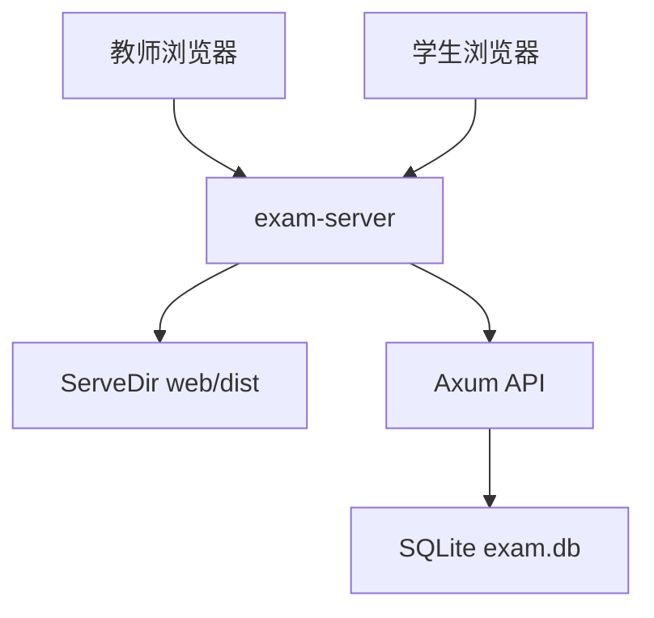
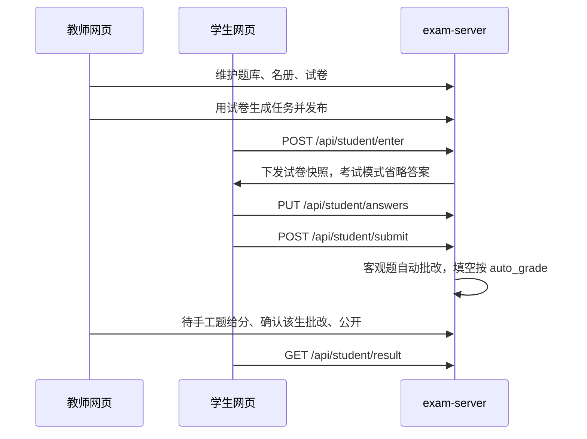
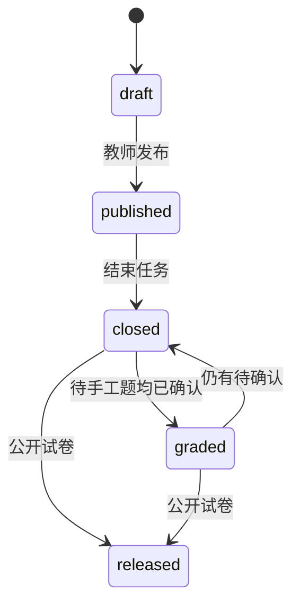

# 架构设计

## 概述

教室在线考试系统在教师机上运行单一 `exam-server` 进程，对外默认监听 `0.0.0.0:8080`。教师浏览器打开 `/teacher.html`，学生浏览器打开 `/student.html?t={task_id}`。开发阶段可用 Vite（5173）把 `/api` 反代到后端。

数据保存在 `EXAM_DATA_DIR`（默认 `./data`）下的 `exam.db`。静态页来自 `EXAM_WEB_DIR`，缺省依次尝试 `web/dist`、`./web/dist`、`web` 以及可执行文件旁的 `web/`。

## 技术栈

**语言与运行时**

- Rust 2021（Cargo workspace）
- TypeScript + Vite 6（教师/学生双入口）

**框架**

- Axum 0.8 + Tokio
- sqlx 0.8 SQLite
- 前端无额外 UI/图表库，图表用 CSS/SVG

**数据存储**

- SQLite，外键开启，时间戳 UTC RFC3339
- 分值为整数

**测试**

- crate 单元/集成测试 + proptest（bank-html、paper-gen、grading）
- exam-server 用 tempfile 独立库

## 项目结构

```text
Cargo.toml
crates/bank-html/          HTML 题库解析与序列化
crates/paper-gen/          抽题、乱序、分值分配
crates/grading/            客观题判分
crates/exam-server/        HTTP、鉴权、任务、静态托管
web/                      Vite 双入口
  teacher.html
  student.html
  src/teacher/
  src/student/
  src/shared/api.ts
testdata/bank-html/       题库夹具
scripts/start-teacher.sh
scripts/start-teacher.bat
```

**入口点**

- `crates/exam-server/src/main.rs`：读配置、迁移、bind、serve
- `crates/exam-server/src/lib.rs`：路由
- `web/src/teacher/main.ts`：讲台
- `web/src/student/main.ts`：学生页

## 子系统

### exam-server

**目的**：HTTP API、教师/学生鉴权、任务状态机、静态资源
**位置**：`crates/exam-server/src/`
**关键文件**：`lib.rs`、`auth.rs`、`banks.rs`、`students.rs`、`papers.rs`、`tasks.rs`、`student.rs`、`results.rs`、`db.rs`
**依赖**：bank-html、paper-gen、grading、SQLite

### bank-html

**目的**：规范 HTML 解析/导出
**位置**：`crates/bank-html/`

### paper-gen

**目的**：按规则抽题、题型内乱序、选项乱序、`allocate_scores`
**位置**：`crates/paper-gen/`

### grading

**目的**：单选/多选/判断始终自动判分；填空是否自动由任务 `auto_grade` 决定；编程题保持未给分
**位置**：`crates/grading/`

### web

**目的**：讲台与学生单页
**位置**：`web/src/`

## 图表







## 关键数据

- `exam_papers`：可复用试卷模板，含 `score_plan_json`、`bank_draws_json`、`live_draw`、`auto_grade`
- `exam_tasks.paper_id`：任务引用试卷；`parent_id` 标记按班拆出的子任务；`auto_grade` 为本场开关
- `classes` + `students`：班级名册
- `papers` / `attempts`：每次作答的快照与答卷；手工分在 `answers_json.code_scores`

## 设计决策

- 单进程单端口，教室断外网仍可用系统字体
- 分值在组卷时写入试卷，任务只复制所选试卷
- 同题型余数加在该题型最后几题
- 空 `task_roster` 进入时回落到全库学生
- 成绩分析服务端聚合；前端图表不用第三方库
- 必要提示用讲台对话框；调分与提前交卷开关不弹窗；打开自动批改需确认
**目的**：单选/多选/判断始终自动判分；填空是否自动由任务 `auto_grade` 决定；编程题保持未给分

Windows 教室包把 `exam-server.exe` 与 `web/` 放在同一目录，由 `start.bat` 设置 `EXAM_WEB_DIR` 和 `EXAM_DATA_DIR`。
