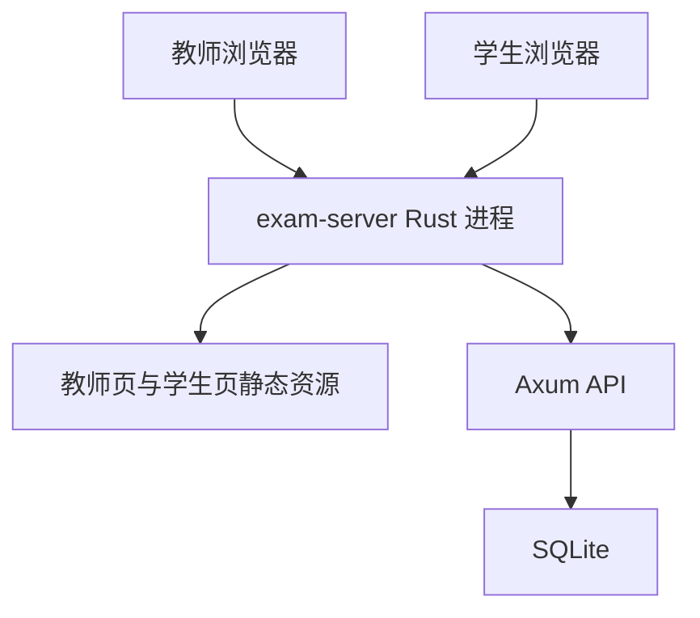
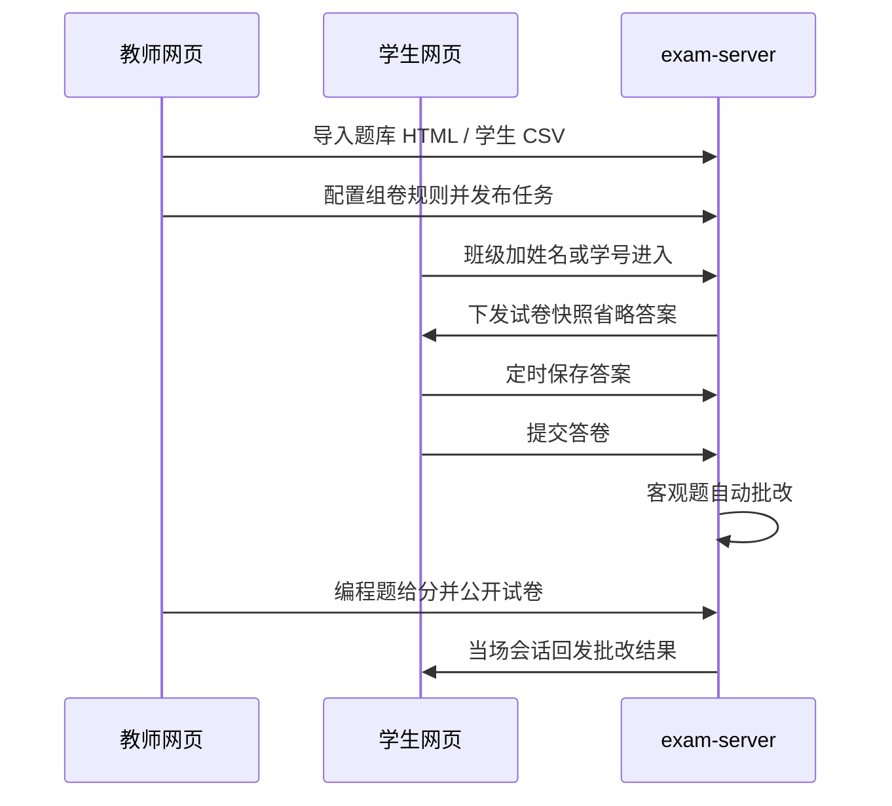
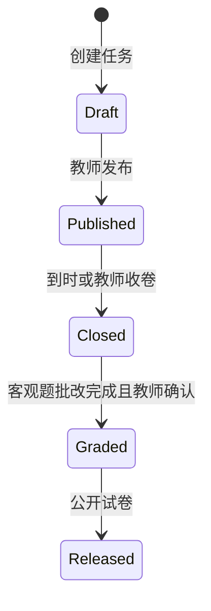

# 教室在线考试系统

Feature Name: online-exam-system
Updated: 2026-11-05

## Description

教师机运行单一 Rust 进程，同时提供 REST API、教师网页与学生网页。数据保存在教师机本地 SQLite。学生通过教室局域网浏览器进入；进入时填写班级，再填写姓名或学号。考试模式提交一次且当时不显示分数，练习模式可重复并立即反馈。客观题自动批改，编程题本阶段人工给分。公开试卷后，当场会话回发到提交所用学生机，历史提交按学生匹配领取。

技术约束：后端 Rust；前端网页；题库导入/导出遵循《题库格式化规范》HTML。

## Architecture

教室局域网内，教师机是唯一服务端。学生机只跑浏览器。预览与部署均由该进程对外暴露一个端口；网页开发阶段由前端开发服务器把 `/api` 反代到后端。







进程内模块划分：

1. `bank-html`：HTML 解析、规范化序列化、语义往返校验。
2. `paper-gen`：抽题、题型内乱序、选项乱序、分值分配。
3. `grading`：客观题判分、填空规范化、多选全对全错。
4. `exam-server`：HTTP、鉴权、任务状态机、会话、导出与分析。

## Components and Interfaces

### exam-server

Axum + Tokio。默认监听 `0.0.0.0:8080`。发布构建把 `web/dist` 嵌进二进制或放在可执行文件旁的 `web/` 目录。路由分区：

- `/teacher/*` 教师单页应用
- `/student/*` 学生单页应用
- `/api/teacher/*` 需教师口令
- `/api/student/*` 需当场会话令牌
- `/api/health` 健康检查

教师口令使用 Argon2 哈希存入 SQLite 配置表。会话令牌为随机 32 字节，服务端保存哈希，Cookie 或 `Authorization` 头传递。

教师机启动后在教师首页列出本机非回环 IPv4 地址，供口述或展示给学生，例如 `http://192.168.1.10:8080/student/`。

### web

Vite + TypeScript。教师端与学生端同一仓库、两个入口，避免两套构建链。开发服务器配置 `allowedHosts: ['.monkeycode-ai.online']`，并将 `/api` 代理到 `http://127.0.0.1:8080`。

教师页主要界面：题库、题目编辑、HTML 导入报告、学生名册、组卷规则、任务监控、批改、成绩与分析。

讲台五模块：题库管理、班级名册、试卷管理、任务管理、成绩分析。组卷结果落在 `exam_papers`；任务引用 `paper_id`。分值在试卷预览内联调整。任务分当前/历史；历史任务详情仍显示答卷入口。成绩分析左历史任务、右数据大屏。

学生页主要界面：班级加姓名或学号进入、作答、已提交、练习反馈、已公开试卷。

### bank-html

输入为符合规范的 HTML 字符串。解析管线：

1. 用 `scraper` 读取 `h1`、`h2`、`h3`、`.question`。
2. 题型标题映射：含「判断」→ 判断题；含「填空」→ 填空题；含「编程」→ 编程题；含「选择」→ 先按答案字母数量判定单选/多选。
3. 选项文本按全角空格或连续空白切分 `A.` `B.` `C.` `D.` 段。
4. 答案：`答案：` / `参考答案：` 后的文本；判断题识别 `✓`、`×`、`正确`、`错误`；填空多答案用 `|`。
5. 每题记录 `source_html` 原始片段，便于失败报告定位。

序列化按规范输出黑白 CSS、系统字体、无外部依赖。pretty-printer 固定缩进 4 空格、属性顺序、选项行格式，便于快照测试。

往返不要求原始空白与实体写法逐字节相同，要求语义字段相等：题型、题干纯文本、选项纯文本、答案规范化值、来源纯文本。

### paper-gen

对每个作答会话执行一次：

1. 按题型从所选题库中无放回随机抽取 N 题。
2. 保持题型分组顺序（选择、判断、填空、编程，仅输出规则中启用的题型）。
3. 题型内如启用随机，则打乱该组小题。
4. 选择题如启用选项随机，则打乱选项并重写卷面字母；快照保存 `option_map`（卷面字母 → 原字母）。
5. 按分值算法写入每题 `points`。

同一学生在同一考试任务中途恢复时复用已有快照，不再重抽。

### grading

对快照中每道客观题计算得分后求和。编程题默认 `null` 分，不计入已出分，直到教师写入整数。教师确认批改完成前，成绩页用「客观分 / 待人工」两列展示。

填空规范化顺序：`trim` → 全角转半角 → 折叠连续空白为单半角空格。大小写敏感，避免编程关键字类填空被误判。

### 成绩分析

全部在服务端用 SQL 与一次内存聚合完成，避免前端自行算分。导出 CSV 使用 UTF-8 BOM，方便 Excel 打开中文。

## Data Models

SQLite，外键开启。时间戳存 UTC RFC3339。金额式分值为整数（分），界面按分显示。

### banks

| 字段 | 类型 | 说明 |
|---|---|---|
| id | TEXT PK | ULID |
| name | TEXT | 题库名 |
| created_at | TEXT | |
| updated_at | TEXT | |

### questions

| 字段 | 类型 | 说明 |
|---|---|---|
| id | TEXT PK | |
| bank_id | TEXT FK | |
| qtype | TEXT | `single` `multiple` `judge` `fill` `code` |
| stem | TEXT | 题干纯文本 |
| stem_html | TEXT | 题干原 HTML（含 `pre`） |
| options_json | TEXT | `[{key,text}]`，非选择题为空数组 |
| answer_json | TEXT | 单选字母 / 多选字母数组 / 判断 bool / 填空字符串数组 / 编程参考代码 |
| source | TEXT | 来源 |
| paper_title | TEXT | 导入时 `h2` |
| imported_from | TEXT | 原文件名 |

### students

| 字段 | 类型 | 说明 |
|---|---|---|
| id | TEXT PK | |
| student_no | TEXT UNIQUE | 学号 |
| name | TEXT | |
| class_name | TEXT | 必填，参与学生匹配 |

### exam_tasks

| 字段 | 类型 | 说明 |
|---|---|---|
| id | TEXT PK | |
| title | TEXT | |
| mode | TEXT | `exam` `practice` |
| status | TEXT | `draft` `published` `closed` `graded` `released` |
| duration_minutes | INTEGER | |
| allow_early_submit | INTEGER | 0/1 |
| total_score | INTEGER | |
| pass_score | INTEGER | 默认 `total_score * 60 / 100` |
| published_at | TEXT | |
| closes_at | TEXT | 发布时刻 + 时长 |

启动后用 `ensure_column` 补列：`paper_id`（引用 `exam_papers`）、`parent_id`（按班拆分的父任务）、`starts_at`。

### classes

| 字段 | 类型 | 说明 |
|---|---|---|
| id | TEXT PK | |
| name | TEXT UNIQUE | 班级名 |

### exam_papers

| 字段 | 类型 | 说明 |
|---|---|---|
| id | TEXT PK | |
| title | TEXT | |
| bank_ids_json | TEXT | |
| type_counts_json | TEXT | |
| shuffle_within_section | INTEGER | |
| shuffle_options | INTEGER | |
| type_subtotals_json | TEXT | 可空 |
| score_plan_json | TEXT | 题型到每题分值数组 |
| bank_draws_json | TEXT | 按库抽题数/比例 |
| total_score | INTEGER | |
| pass_score | INTEGER | |
| created_at | TEXT | |
| updated_at | TEXT | |

### paper_rules

| 字段 | 类型 | 说明 |
|---|---|---|
| task_id | TEXT PK FK | |
| bank_ids_json | TEXT | |
| type_counts_json | TEXT | `{single:20, judge:10, ...}` |
| shuffle_within_section | INTEGER | |
| shuffle_options | INTEGER | |
| type_subtotals_json | TEXT | 可空 |
| score_plan_json | TEXT | 调分后每题型每题分值 |
| bank_draws_json | TEXT | 按库抽题配额，可空 |

### task_roster

| 字段 | 类型 | 说明 |
|---|---|---|
| task_id | TEXT | |
| student_id | TEXT | |
| PRIMARY KEY | (task_id, student_id) | |

### papers

| 字段 | 类型 | 说明 |
|---|---|---|
| id | TEXT PK | |
| task_id | TEXT | |
| student_id | TEXT | |
| attempt_no | INTEGER | 考试固定 1；练习从 1 递增 |
| items_json | TEXT | 题目 id、卷面顺序、option_map、points |
| created_at | TEXT | |
| UNIQUE | (task_id, student_id, attempt_no) | |

### attempts

| 字段 | 类型 | 说明 |
|---|---|---|
| id | TEXT PK | |
| paper_id | TEXT | |
| client_id | TEXT | 学生机本地生成并上报 |
| status | TEXT | `in_progress` `submitted` |
| answers_json | TEXT | 题号到作答 |
| objective_score | INTEGER | |
| total_score | INTEGER | 含人工分；未齐时为已出分 |
| submitted_at | TEXT | |

### sessions

| 字段 | 类型 | 说明 |
|---|---|---|
| token_hash | TEXT PK | |
| role | TEXT | `teacher` `student` |
| student_id | TEXT | |
| task_id | TEXT | |
| client_id | TEXT | |
| expires_at | TEXT | |

### settings

| 字段 | 类型 | 说明 |
|---|---|---|
| key | TEXT PK | 如 `teacher_password_hash` |
| value | TEXT | |

## Correctness Properties

- 任意已确认组卷规则下，试卷快照中各题 `points` 均为正整数，且总和等于 `total_score`。
- 考试模式对同一 `(task_id, student_id)` 至多一份 `attempt_no = 1` 且状态为 `submitted` 的记录。
- 考试模式在 `released` 之前，学生 API 返回的试卷与提交结果不含 `answer_json`、参考答案与得分。
- 选项乱序后，用 `option_map` 还原的正确答案集合与题库原答案集合相等。
- `parse(pretty_print(questions))` 与原 `questions` 在语义字段上相等。
- 公开试卷时，若 `attempts.client_id` 对应会话未过期，批改结果只投递给该 `client_id`；否则归档到该 `student_id`，下次学生匹配成功后领取。
- 填空判分对「全角数字/字母/竖线」与半角等价形式给出相同对错结论。

## Error Handling

| 场景 | 处理 |
|---|---|
| HTML 整文件无法解析 | HTTP 400，不写库，返回原因 |
| HTML 部分题目失败 | 200 + 导入报告；失败题不入库 |
| CSV 缺列或缺必填 | 跳过坏行，返回行号 |
| 题量不足 | 409，组卷失败，任务保持草稿 |
| 班级缺失，或姓名与学号都空 | 400 |
| 学生匹配命中 0 人 | 403，名单中无此学生 |
| 同班重名且未填学号 | 409，提示改填学号 |
| 学号与姓名指向不同记录 | 403，姓名与学号不匹配 |
| 考试重复提交 | 409 |
| 禁止提前交卷时学生点提交 | 403，提示等待结束或教师允许 |
| 删除已被快照引用的题目 | 409 |
| 教师口令错误 | 401 |
| 学生心跳中断 | 保留 `in_progress` 与已保存答案，教师监控显示作答中 |
| SQLite 锁等待超时 | 503，前端自动重试保存答案 |
| 公开时学生不在线 | 归档到该学生的已公开列表，下次进入领取 |

所有 API 错误体统一 `{ "error": { "code": "...", "message": "中文说明", "details": {} } }`。

## Test Strategy

### bank-html

- 用规范样例 HTML 做解析快照。
- 单选、多选、判断（✓/×）、填空多答案、编程参考答案各至少 1 份夹具。
- pretty-print 后再 parse，断言语义字段相等。
- 缺 `.question`、答案缺失、选项切分失败的负例。

### paper-gen

- 固定 RNG 种子：断言题量、题型内乱序、选项映射可逆、分值总和。
- 题量不足返回错误。
- 分项小计与总分不一致时的缩放与余数分配。

### grading

- 单选映射后判分。
- 多选全对满分、少选/多选/错选零分。
- 填空 trim、全角半角、`|` 多答案。
- 编程题保持未给分。

### exam-server

- 考试模式提交后学生接口不含答案。
- 练习模式提交后含答案与分数，并可第二次作答。
- 提前交卷开关切换对未提交会话立即生效。
- 到时收卷把 `in_progress` 转为 `submitted`。
- 公开试卷：在线按 `client_id` 投递，离线按学生匹配后的 `student_id` 领取。
- 进入：班级加学号命中、班级加姓名唯一命中、同班重名要求学号、学号姓名冲突拒绝。

冒烟测试使用临时目录中的独立 SQLite 文件，不读取用户本机已有数据文件。

## 分值自动调整算法

设总分 `T`，启用题型集合 `I`，题型 `i` 题量 `n_i`，全卷题量 `N = sum n_i`。

1. 若教师给出题型小计 `S_i` 且 `sum S_i == T`：对每个题型，`q = S_i / n_i` 取整，`r = S_i % n_i`，该题型最后 `r` 小题为 `q+1`，其余为 `q`。
2. 若给出 `S_i` 但 `sum S_i != T`：令 `S'_i = round(T * S_i / sum S_j)`，再把 `sum S'_i` 与 `T` 的差从题型列表头部逐项加减 1，然后执行步骤 1。
3. 若未给出 `S_i`：等价于把 `T` 按 `N` 做步骤 1 的余数分配，分配顺序为题型顺序 × 题号顺序。
4. 若某题分值被调成 0：从分值最高的一题借 1 分，保证每题至少 1 分；若 `T < N`，拒绝保存规则并提示总分必须大于等于题量。

教师在试卷预览确认或修改分值后，`exam_papers.score_plan_json` 固化。任务复制该方案；已生成学生快照不再回溯修改。

## 查漏补缺（已纳入本阶段）

用户原文未写、但教室落地必需的能力，已写入需求与本设计：

1. 作答时长与到时强制收卷，避免考试无法结束。
2. 未交卷答案定时落库与断线续答，避免机房网络抖动丢答。
3. 教师口令，避免学生打开教师页改分。
4. 教师首页展示局域网地址，避免学生找不到入口。
5. 考试模式 API 剥离答案字段，避免从开发者工具直接读到正确答案。
6. HTML 导入部分失败报告，避免整文件因一题损坏全部作废或静默丢题。
7. 多选题：规范里答案可能是多字母，按字母数区分单选/多选。
8. 填空多答案与全角半角规范化。
9. 任务监控（未进入 / 作答中 / 已提交）与教师一键收卷。
10. 及格线默认为满分 60%，可改。
11. 同一考试任务中途重进复用试卷快照，避免刷新浏览器换题。

明确推迟：编程题在线评测、公式与图片题、多教师账号、强制锁屏。

## 仓库目录规划

```text
/workspace
  Cargo.toml                 # workspace
  crates/bank-html/          # 解析与序列化
  crates/paper-gen/          # 组卷与调分
  crates/grading/            # 客观题批改
  crates/exam-server/        # Axum 服务与嵌入式静态资源
  web/                       # Vite + TypeScript
    src/teacher/
    src/student/
    src/shared/
  testdata/bank-html/        # 规范夹具
  scripts/start-teacher.bat  # Windows 启动，CRLF，goto 风格
  scripts/start-teacher.sh
  .monkeycode/specs/2026-11-01-online-exam-system/
```

默认数据目录为教师机可写路径 `./data/exam.db`，可通过环境变量 `EXAM_DATA_DIR` 覆盖。冒烟与测试使用临时目录。

## API 草稿

完整路由见 `.monkeycode/docs/INTERFACES.md`。此处列与初稿相比新增的关键接口：

- 班级：`/api/teacher/classes`
- 试卷模板：`/api/teacher/papers`、`GET/PATCH /api/teacher/papers/{id}`、`GET .../preview`
- 任务名单：`GET/PUT /api/teacher/tasks/{id}/roster`（PUT 成功 200 JSON）
- 按班拆分：`POST /api/teacher/tasks/{id}/split`
- 学生摘要/互查：`GET /api/student/brief`、`GET /api/student/lookup`
- 进入：`class_name` 可空；`name` 与 `student_no` 至少一项；空名单回落全库

## References

[^1]: (Filename) - 题库格式化规范缓存 `.monkeycode-tmp-files/42a8f00a-题库规范化格式-1.html`
[^2]: (Spec) - 需求文档 `.monkeycode/specs/2026-11-01-online-exam-system/requirements.md`

已确认决策：编程题本阶段仅人工给分；部署形态为教室局域网单教师机；学生进入采用班级（可空）加姓名或学号匹配。

## 学生匹配算法

输入：`name` 与 `student_no` 至少一项，`class_name` 可空。匹配范围：`task_roster` 有人则用名单，空名单回落全库 `students`。

1. 若提供 `student_no`：按学号命中。若同时提供班级或姓名，必须与该行一致。
2. 若未提供学号、仅提供姓名：按姓名命中，可选再过滤班级。零条失败；一条命中；两条及以上要求改填学号。
3. 命中后建立会话，后续答卷、续答、公开试卷领取都绑定该 `student_id`。
