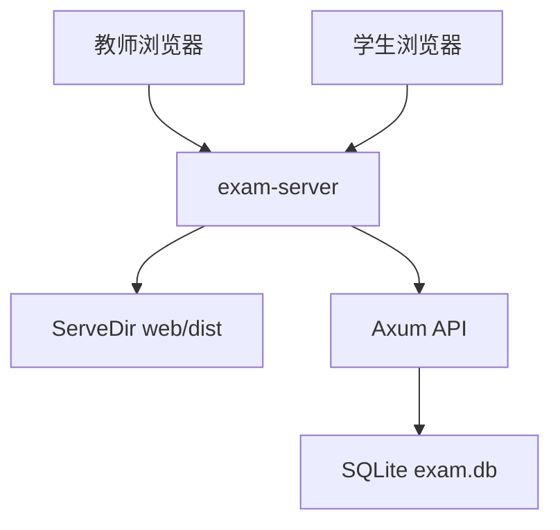
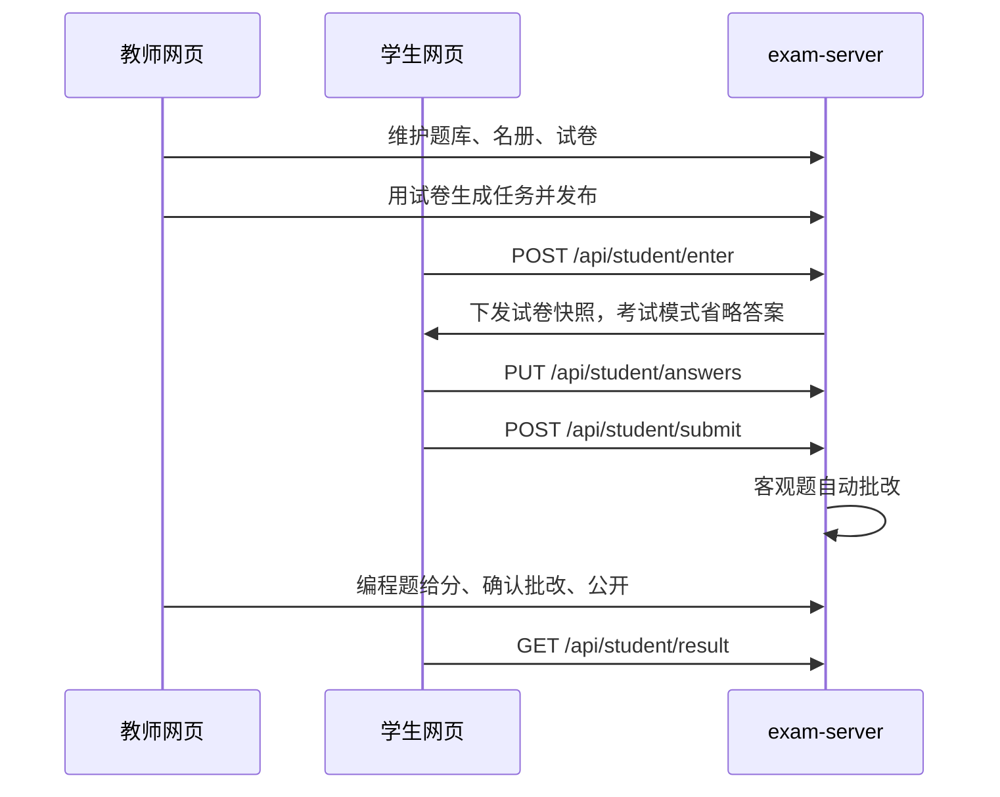
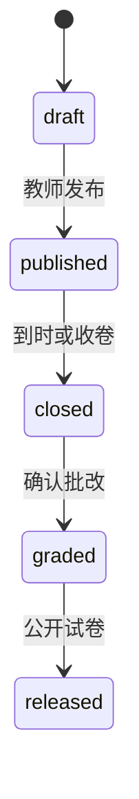

# 教室在线考试系统 · 设计文档

教师机运行单一 Rust 进程 `exam-server`，同时提供 REST API、讲台网页与学生网页。数据保存在本机 SQLite。学生通过教室局域网浏览器进入。客观题自动批改，编程题本阶段由教师人工给分。

配套文档：[使用文档.md](./使用文档.md)、[题库规范化格式.md](./题库规范化格式.md)。

## 1. 目标与边界

**覆盖**

- 题库维护：规范 HTML 导入/导出，讲台增改删题目
- 班级名册：CSV 导入、按班管理
- 可复用试卷：固定卷或智能实时组卷，组卷时确定分值
- 考试任务：草稿、发布、监考、收卷、确认批改、公开
- 学生作答：匹配进入、续答、定时保存、按开关提前交卷
- 成绩：列表、CSV、服务端聚合分析

**本阶段不做**

- 编程题在线评测
- 公式与图片题
- 多教师账号
- 强制锁屏

## 2. 总体架构

默认监听 `0.0.0.0:8080`。教师打开 `/teacher.html`，学生打开 `/student.html?t={task_id}`。开发阶段可用 Vite（5173）把 `/api` 反代到后端。

数据目录 `EXAM_DATA_DIR`（默认 `./data`）下的 `exam.db`。静态页来自 `EXAM_WEB_DIR`，缺省依次尝试 `web/dist`、`./web/dist`、`web` 以及可执行文件旁的 `web/`。





**技术栈**：Rust 2021（Cargo workspace）、Axum 0.8、Tokio、sqlx 0.8 SQLite、TypeScript + Vite 6。前端图表用 CSS/SVG，无第三方图表库。分值为整数。时间戳 UTC RFC3339。

## 3. 仓库结构

```text
Cargo.toml
crates/bank-html/          HTML 题库解析与序列化
crates/paper-gen/          抽题、乱序、分值分配
crates/grading/            客观题判分
crates/exam-server/        HTTP、鉴权、任务、静态托管
web/                      Vite 双入口 teacher.html / student.html
testdata/bank-html/       题库夹具
scripts/start-teacher.sh
scripts/start-teacher.bat
docs/                     本目录：设计、使用、题库规范
```

| 模块 | 职责 |
|---|---|
| `bank-html` | 读 `h1/h2/h3/.question/.options/.answer`；pretty-print 规范 HTML |
| `paper-gen` | 按规则抽题、题型内乱序、选项乱序、`allocate_scores` |
| `grading` | 单选/多选/判断/填空自动判分；编程题保持未给分 |
| `exam-server` | 路由、SQLite、教师/学生鉴权、任务状态机 |
| `web` | 讲台五模块与学生作答页 |

`exam-server` 源文件：`auth.rs` 口令与令牌，`lan.rs` 局域网地址，`banks.rs` 题库，`students.rs` 名册，`papers.rs` 试卷模板，`paper.rs` 快照，`tasks.rs` 任务状态机，`student.rs` 学生作答，`results.rs` 成绩与分析，`db.rs` 迁移。

## 4. 关键设计决策

- 单进程单端口，教室断外网仍可用系统字体打开网页。
- 先组试卷再派任务；分值写在试卷上，任务只引用试卷。
- 新建试卷默认**固定卷**；勾选「智能实时组卷」后每次预览和每位考生重新抽题。
- 固定卷学生看到的题序、选项序与答题时快照一致；教师查看学生答卷也用该快照。
- 智能实时组卷的成绩分析不展示题目分析（每位考生题目不同）。
- 考试模式在公开前剥离答案与得分；练习模式提交后立即反馈。
- 同一学生同一考试任务中途重进复用快照，避免刷新换题。
- 学生会话令牌按任务隔离。
- 空任务名单回落到全库学生。
- 必要提示用讲台对话框；调分与提前交卷开关不弹窗。

## 5. 试卷：固定卷与智能实时组卷

表 `exam_papers.live_draw`：

| 模式 | 创建时 | 预览 | 学生进入 |
|---|---|---|---|
| 固定试卷（默认） | 生成并冻结 `items_json` | 使用冻结卷面 | 每位考生拿到同一份卷面（可叠加乱序规则已固化的结果） |
| 智能实时组卷 | 不冻结题目 | 每次重新抽题（预览关闭乱序便于核分） | 每位考生按规则重抽，分值套用已存 `score_plan` |

库内旧试卷若缺列，读取时 `live_draw` 缺省为 1，保持历史实时抽题行为。

## 6. 组卷与分值

算法在 `paper-gen::allocate_scores`：

1. 总分 `T` 必须 `>=` 题量 `N`，否则拒绝。
2. 有题型小计且之和等于 `T`：按题型分配。
3. 有小计但之和不等于 `T`：按比例缩放到 `T` 后再分配。
4. 未给小计：按题量比例分到各题型，余数落在最后一种题型。
5. 同一题型内：每题先得整数商，余数加在该题型**最后**几题。
6. 若出现 0 分题，从分值最高的题借 1 分。

讲台在试卷预览每道大题标题旁内联改分，失焦保存。已生成学生快照不再回溯改分。

选择题选项乱序后，快照保存 `option_map`（卷面字母 → 原字母），判分时还原。

## 7. 判分

| 题型 | 规则 |
|---|---|
| 单选 / 判断 | 对满分，错零分 |
| 多选 | 所选集合与正确答案完全相同才满分，否则零分 |
| 填空 | `trim` → 全角转半角 → 折叠空白；`|` 或多条期望任一匹配即对；大小写敏感 |
| 编程 | `awarded = null`，等教师 `PUT /api/teacher/attempts/{id}/code-scores` |

填空导入：ASCII `()` 保留，因此 `print("Hello")`、`float("3.14")`、`random.randint(1, 100)` 能原样入库；中文 `（）` 当作注释括号剥掉。判分时全角字符会转到半角，双引号与单引号仍按入库文本匹配。

教师确认批改前，成绩页用「客观分 / 待人工」展示。

## 8. 任务状态



| 状态 | 含义 | 讲台分区 |
|---|---|---|
| `draft` | 可改名单、拆班、删除、发布 | 当前任务 |
| `published` | 进行中，可收卷、改提前交卷 | 当前任务 |
| `closed` | 已收卷 | 历史任务 |
| `graded` | 已批改 | 历史任务 |
| `released` | 已公开，学生可看分析 | 历史任务 |

草稿且覆盖多个班级时可拆分子任务（按班生成后删除原任务）。发布后冻结名单。收卷把未提交会话用已保存答案提交。

作答记录 `attempts.status`：`in_progress` / `submitted`。监控映射为未进入、作答中、已提交。

考试模式对同一 `(task_id, student_id)` 至多一份 `attempt_no = 1` 的提交。练习可重复，`attempt_no` 递增。

## 9. 学生匹配与会话

进入时用班级、姓名、学号在当前任务名单中解析到唯一学生：

1. 提供学号：按学号命中；若同时给班级或姓名，必须与该行一致。
2. 只提供姓名：按姓名命中，可选再过滤班级；0 人 403；多人 409 要求改填学号。
3. `class_name` 可空。学生页可姓名/学号互查。

当场会话绑定 `client_id`。同一学生换机器重进，后续作答接到最新通过校验的客户端，快照与已答内容继续用。公开试卷时，在线按 `client_id` 投递，离线按 `student_id` 下次领取。

## 10. 成绩分析

全部在服务端聚合。默认分数段 5 个分界：总分的 60%、70%、80%、90%、95%，形成 6 段（含 `≥95%`）。讲台可改及格分和 5 个分界。接口 `GET /api/teacher/tasks/{id}/analysis` 支持 `pass_score`、`bands=a,b,c,d,e`。

大屏含平均/最高/最低/中位、标准差、四分位、及格/优秀/良好/满分、按班统计。题目分析按大题汇总正确率、得分率、均分。智能实时组卷任务不返回题目分析。

导出 CSV 使用 UTF-8 BOM。

## 11. 题库 HTML

导入/导出遵循 [题库规范化格式.md](./题库规范化格式.md)。

解析：`h1` 为文档标题，`h2` 为试卷/分组，`h3` 为题型，`.question` 为题目。导出始终走 `pretty_print`：UTF-8、`lang="zh-CN"`、黑白 CSS、正文 SimSun、标题与 `.answer` 用 SimHei，并开启 `antialiased`，避免「答案：A」因宋体合成加粗发绿。下载头 `Content-Disposition` 使用题库名。

已被已发布快照引用的题目不可删除（409）。

## 12. 数据模型

SQLite，外键开启。主键多为 ULID 文本。

| 表 | 作用 |
|---|---|
| `banks` / `questions` | 题库与题目（`qtype`：`single` `multiple` `judge` `fill` `code`） |
| `classes` / `students` | 班级与名册（学号唯一） |
| `exam_papers` | 可复用试卷：抽题规则、`score_plan_json`、`bank_draws_json`、`live_draw`、`items_json` |
| `exam_tasks` | 任务：`mode`（`exam`/`practice`）、状态、时长、`paper_id`、`parent_id` |
| `paper_rules` | 创建任务时从试卷复制的规则 |
| `task_roster` | 任务名单 |
| `papers` | 每位学生的作答快照 |
| `attempts` | 作答内容与分数 |
| `sessions` | 教师/学生令牌哈希 |
| `settings` | 教师口令哈希等 |

## 13. HTTP 接口

统一错误体：`{ "error": { "code": "...", "message": "中文说明", "details": {} } }`。`GET /api/health` 返回纯文本 `ok`。教师接口除 setup/login 外需要教师令牌。学生作答接口需要学生会话令牌。

根路径 `/`、`/teacher` 307 到 `/teacher.html`；`/student` 307 到 `/student.html`。

### 公开

| 方法 | 路径 | 说明 |
|---|---|---|
| GET | `/api/health` | 健康检查 |
| POST | `/api/teacher/setup` | 首次设口令 |
| POST | `/api/teacher/login` | 教师登录 |
| POST | `/api/student/enter` | 学生进入 |
| GET | `/api/student/brief` | 任务摘要 |
| GET | `/api/student/lookup` | 姓名/学号互查 |

### 教师

| 方法 | 路径 | 说明 |
|---|---|---|
| PUT | `/api/teacher/password` | 改口令 |
| GET | `/api/teacher/lan-addresses` | 本机非回环 IPv4 |
| GET/POST | `/api/teacher/banks` | 题库列表/创建 |
| GET/PATCH/DELETE | `/api/teacher/banks/{id}` | 详情/改名/删除 |
| POST | `/api/teacher/banks/{id}/questions` | 新增题目 |
| PUT/DELETE | `/api/teacher/questions/{id}` | 改题/删题 |
| POST | `/api/teacher/banks/{id}/import-html` | 导入规范 HTML |
| GET | `/api/teacher/banks/{id}/export-html` | 导出规范 HTML |
| GET/POST | `/api/teacher/students` | 学生列表/登记 |
| POST | `/api/teacher/students/import-csv` | CSV（班级、学号、姓名） |
| PATCH/DELETE | `/api/teacher/students/{id}` | 改/删学生 |
| GET | `/api/teacher/students.csv` | 导出名册 |
| GET | `/api/teacher/student-template.csv` | 名册模板 |
| GET/POST | `/api/teacher/classes` | 班级 |
| GET/POST | `/api/teacher/papers` | 试卷列表/组卷 |
| GET/PATCH/DELETE | `/api/teacher/papers/{id}` | 详情；PATCH 写入分值方案 |
| GET | `/api/teacher/papers/{id}/preview` | 预览 |
| GET/POST | `/api/teacher/tasks` | 任务 |
| GET/PUT | `/api/teacher/tasks/{id}/roster` | 名单；PUT 仅草稿 |
| POST | `/api/teacher/tasks/{id}/split` | 按班拆分 |
| POST | `/api/teacher/tasks/{id}/publish` | 发布 |
| POST | `/api/teacher/tasks/{id}/close` | 收卷 |
| POST | `/api/teacher/tasks/{id}/grade` | 确认批改 |
| POST | `/api/teacher/tasks/{id}/release` | 公开试卷 |
| GET | `/api/teacher/tasks/{id}/monitor` | 监控 |
| GET | `/api/teacher/tasks/{id}/results` | 成绩 |
| GET | `/api/teacher/tasks/{id}/results.csv` | 成绩 CSV |
| GET | `/api/teacher/tasks/{id}/analysis` | 分析 |
| PUT | `/api/teacher/attempts/{id}/code-scores` | 编程题给分 |

### 学生（需会话）

| 方法 | 路径 | 说明 |
|---|---|---|
| GET | `/api/student/paper` | 当前试卷；未公开时省略答案 |
| PUT | `/api/student/answers` | 保存答案 |
| POST | `/api/student/submit` | 提交 |
| GET | `/api/student/result` | 练习提交后或考试已公开后的逐题详情 |

前端令牌：讲台 `localStorage exam_teacher_token`；学生 `exam_student_token`，客户端标识 `exam_student_client_id`。

## 14. 错误处理

| 场景 | 处理 |
|---|---|
| HTML 整文件无法解析 | 400，不写库 |
| HTML 部分题目失败 | 200 + 导入报告；失败题不入库 |
| CSV 缺列或缺必填 | 跳过坏行，返回行号 |
| 题量不足 | 409，组卷失败 |
| 学生匹配 0 人 | 403 |
| 同名未填学号 | 409 |
| 考试重复提交 | 409 |
| 禁止提前交卷 | 403 |
| 删除已被快照引用的题目 | 409 |
| 教师口令错误 | 401 |
| SQLite 锁等待超时 | 503，前端重试保存 |

## 15. 部署与配置

| 变量 | 默认 | 说明 |
|---|---|---|
| `EXAM_DATA_DIR` | `./data` | 数据目录，库文件为 `exam.db` |
| `EXAM_BIND` | `0.0.0.0:8080` | 监听地址 |
| `EXAM_WEB_DIR` | 探测 `web/dist` 等 | 静态资源目录 |

教室启动：`./scripts/start-teacher.sh run`（先构建前端再跑后端）。开发：`./scripts/start-teacher.sh dev`。Windows 用 `scripts/start-teacher.bat`。

教师口令使用 Argon2 哈希写入 `settings`。会话令牌为随机 32 字节，服务端只存哈希。

## 16. 测试

- `bank-html`：规范样例解析、填空括号、pretty-print 往返
- `paper-gen`：固定种子抽题、分值总和、选项映射可逆
- `grading`：单选映射、多选全对全错、填空、编程未给分
- `exam-server`：导入导出、考试/练习流程、固定卷与实时卷、分析分数段

测试使用 tempfile 独立库，不读本机 `./data`。`cargo test` 不更新正在运行的二进制，改完入口后需重新 `cargo run`。
